<div align="center">
  
</div>

<br/>

<p align="center">
  <a href="https://www.linkedin.com/in/ekow-mensah/"></a>
  <a href="mailto:ekow.y.mensah@gmail.com"></a>
  <a href="https://github.com/ekow-mensah/ekow-mensah/issues"></a>
  
</p>

<br/>

### About

```ts
const ekow = {
  role:       "Software Engineer — APIs & web apps",
  experience: "6+ years",
  building:   "WeGoo — a logistics marketplace connecting local delivery companies to e-commerce businesses & SMEs",
  learning:   ["Go", "backend systems design"],
  education:  "MSc Advanced Computer Science, Loughborough University",
};
```

<br/>

### Stack


<br/>


<br/><br/>

### Activity

<div align="center">


<picture>
  <source media="(prefers-color-scheme: dark)" srcset="https://raw.githubusercontent.com/ekow-mensah/ekow-mensah/output/snake-dark.svg" />
  <source media="(prefers-color-scheme: light)" srcset="https://raw.githubusercontent.com/ekow-mensah/ekow-mensah/output/snake-light.svg" />
  
</picture>

</div>
